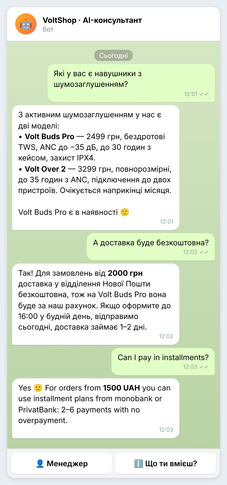
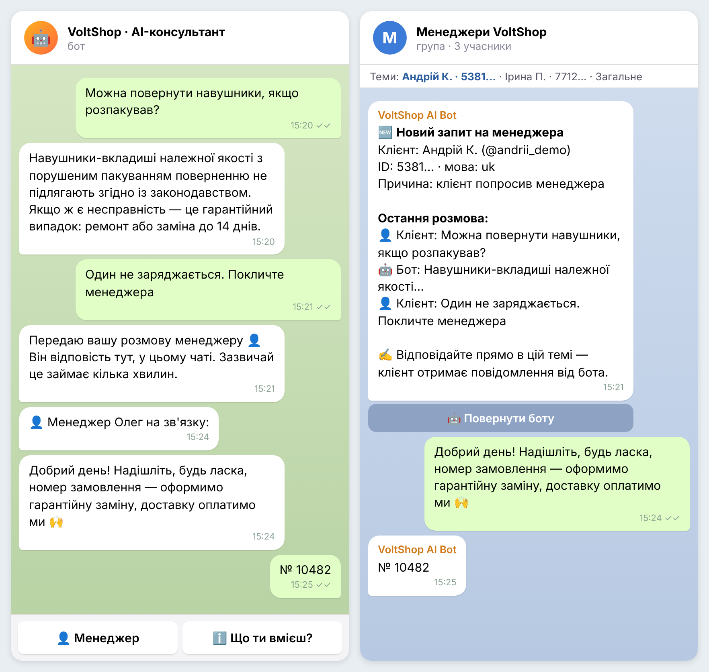
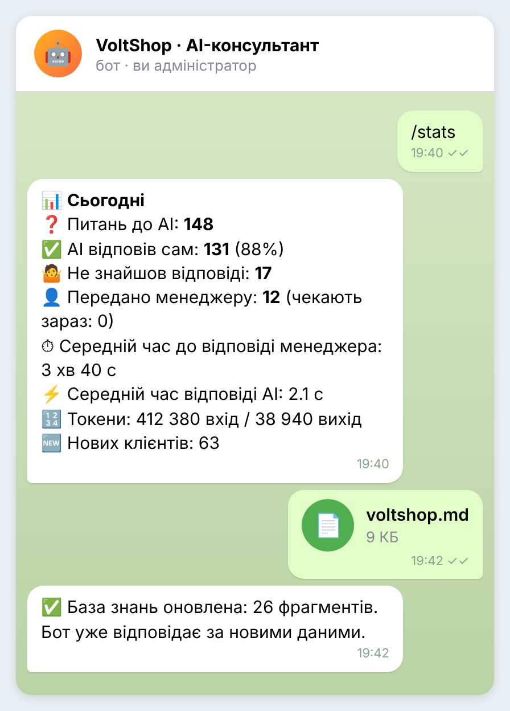

# AI-консультант для інтернет-магазину (Telegram + Gemini + RAG)

Telegram-бот, який відповідає клієнтам магазину на питання про товари, доставку, оплату, гарантію та повернення — **лише за базою знань магазину**, без вигадок. Якщо відповіді немає або клієнт просить живу людину, бот **передає розмову менеджеру**: у робочій групі для кожного клієнта створюється окрема тема, менеджер відповідає там, а клієнт отримує відповідь у звичайному чаті з ботом.

Демо-дані: вигаданий магазин гаджетів **VoltShop** (`knowledge/voltshop.md`).

## Скриншоти

_Приклади діалогів з демо-даними магазину VoltShop._

| Відповіді AI за базою знань | Передача менеджеру | Статистика та оновлення бази |
|---|---|---|
|  |  |  |

## Можливості

**Для клієнта**
- Відповіді звичайною мовою на основі бази знань магазину (RAG: пошук релевантних фрагментів + генерація відповіді через Gemini).
- Пам'ять розмови: бот враховує останні 5 повідомлень («а скільки він коштує?» після питання про товар).
- Не вигадує: якщо відповіді в базі немає — чесно каже про це й пропонує менеджера.
- Відповідає мовою клієнта: українська, російська, англійська (інтерфейс бота теж трьома мовами).
- Кнопка «👤 Менеджер» і автоматичне розпізнавання фраз на кшталт «покличте оператора», «talk to a manager».

**Для менеджерів**
- Кожен клієнт — окрема тема (topic) у групі менеджерів з історією розмови та причиною звернення.
- Менеджер відповідає прямо в темі: текст, фото, файли — клієнт отримує все від імені бота.
- Кнопка «🤖 Повернути боту» або команда `/close` завершує розмову, і клієнт знову спілкується з AI.

**Для власника**
- `/stats` — статистика за сьогодні, 7 днів і весь час: скільки питань закрив AI, скільки пішло менеджеру, середній час відповіді менеджера й AI, витрачені токени.
- Оновлення бази знань без програміста: надішліть боту `.md` або `.txt` файл — індекс перебудується автоматично. Якщо в новому файлі помилка, повертається стара версія.
- Логи: `logs/bot.log` (робота бота) і `logs/metrics.log` (для кожного запиту: користувач, результат, токени, затримка в мс).

## Як це працює

```
Клієнт ──► Telegram ──► бот (aiogram 3)
                          │
                          ├─ просить людину? ──► тема в групі менеджерів ◄──► менеджер
                          │
                          ▼
              питання + попереднє повідомлення
                          │
                          ▼
             ембединг запиту (Gemini embeddings)
                          │
                          ▼
         ChromaDB: 4 найближчі фрагменти бази знань
                          │
                          ▼
   системний промпт (правила + фрагменти) + історія (SQLite) ──► Gemini
                          │
                          ▼
       відповідь ──► клієнту   |   [[NO_ANSWER]] ──► «покликати менеджера?»
```

База знань ділиться на фрагменти за заголовками Markdown (довгі розділи — на шматки до 900 символів із перекриттям), до кожного фрагмента додається шлях заголовків («Доставка › Нова Пошта»), щоб пошук і модель краще розуміли контекст.

## Технології

Python 3.10+ · aiogram 3 · Google Gemini API (`google-genai`) · ChromaDB · SQLite · Docker

## Структура

```
ai_consultant_bot/
├── main.py              # запуск бота
├── ingest.py            # окремий скрипт індексації бази знань (+ перевірка пошуку)
├── config.py            # налаштування з .env
├── knowledge/           # база знань магазину (.md / .txt)
├── app/
│   ├── assistant.py     # логіка AI-консультанта: пошук → промпт → відповідь
│   ├── handoff.py       # передача розмови менеджеру (теми в групі)
│   ├── db.py            # SQLite: клієнти, історія, статистика
│   ├── texts.py         # тексти інтерфейсу (uk / ru / en)
│   ├── keyboards.py
│   ├── rag/
│   │   ├── chunker.py   # розбиття бази знань на фрагменти
│   │   ├── knowledge.py # індекс у ChromaDB і пошук
│   │   └── gemini.py    # ембединги та генерація через Gemini
│   └── handlers/        # client.py · manager.py · admin.py
├── tests/               # тести без мережі (Gemini і ChromaDB підмінено)
├── Dockerfile
└── docker-compose.yml
```

## Запуск

### 1. Підготовка в Telegram
1. Створіть бота в [@BotFather](https://t.me/BotFather) і отримайте токен.
2. Створіть групу для менеджерів, у налаштуваннях групи увімкніть **Теми (Topics)**.
3. Додайте бота в групу як **адміністратора** з правом **керувати темами**.
4. Напишіть у групі `/id` — бот покаже ID групи (починається з `-100`). Напишіть `/id` боту в особисті — побачите свій ID для `ADMIN_IDS`.

### 2. Ключ Gemini
Отримайте безкоштовний ключ на [Google AI Studio](https://aistudio.google.com) → **Get API key**.

### 3. Налаштування
Скопіюйте `.env.example` у `.env` і заповніть `BOT_TOKEN`, `GEMINI_API_KEY`, `MANAGER_CHAT_ID`, `ADMIN_IDS`.

### 4. Локально (Windows)
```bash
py -3.12 -m venv .venv
.venv\Scripts\activate
pip install -r requirements.txt
python main.py
```
Linux/macOS: `python3 -m venv .venv && source .venv/bin/activate`.

Під час першого запуску бот сам проіндексує `knowledge/`. Перевірити пошук без бота:
```bash
python ingest.py "скільки коштує доставка Укрпоштою"
```

### 5. На сервері через Docker
```bash
docker compose up -d --build
docker compose logs -f
```

## Своя база знань

Замініть `knowledge/voltshop.md` на свій файл (або надішліть його боту як адміністратор). Рекомендації:
- структуруйте заголовками: `## Доставка`, `### Нова Пошта` — так пошук точніший;
- пишіть факти прямо: ціни, терміни, умови;
- один товар — один розділ із назвою в заголовку.

## Тести

```bash
python -m pytest
```
16 тестів: розбиття бази знань, розпізнавання прохань про менеджера, безпечне HTML-форматування, база даних і статистика, повний RAG-цикл з підробленими Gemini та ChromaDB (без мережі й ключів).
